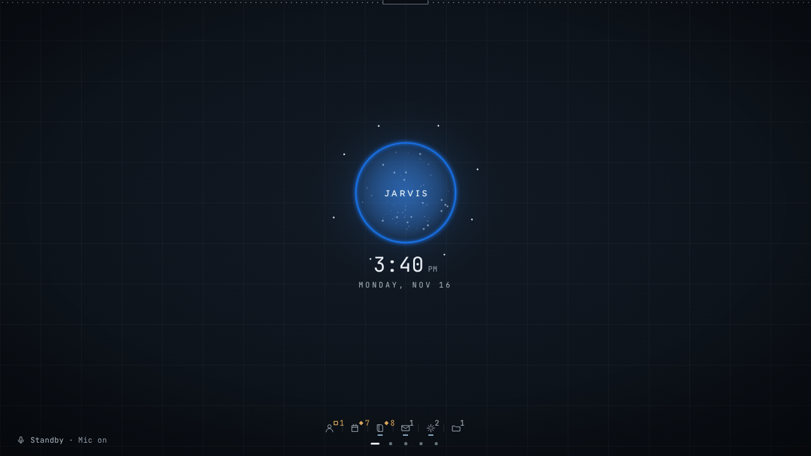
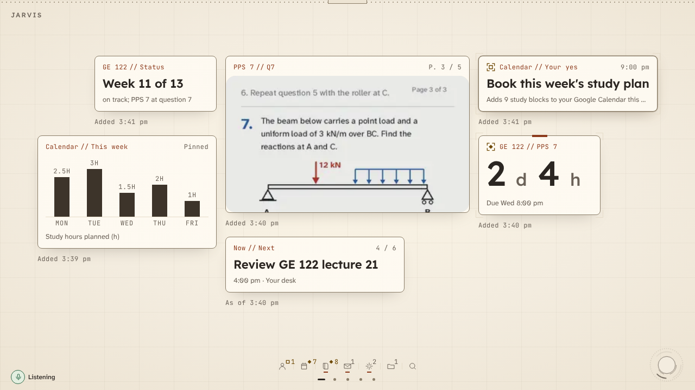
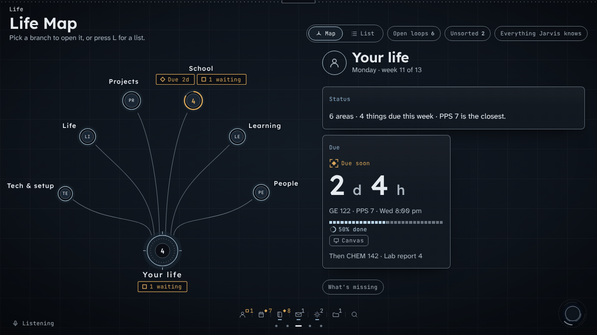

# Jarvis

A personal AI assistant I'm building for my life as a first-year electrical engineering student. You talk to it,
it knows your classes, deadlines and files, and it takes care of the busywork: planning the week, pulling up the
problem set you need, tracking what's due, opening apps and files, and catching problems before they happen.

This repository is the **hub**: the desktop app where everything Jarvis knows and does can be seen, checked,
edited and undone. Nothing he does is hidden.



| Working on a problem set | The Life Map |
| --- | --- |
|  |  |

## What it does

- **Talks like a person.** Voice in and out, with a wake word. He waits for you to finish a thought, answers
  in a sentence or two, and goes quiet while you work.
- **Knows your context.** Classes, assignments, due dates and course files are pulled in from the sources you
  already use, so you don't have to fill in forms.
- **Asks before acting.** Anything that changes your calendar, files or messages shows up as a proposal you can
  accept, change or decline.
- **Remembers, with an undo.** Every fact Jarvis keeps shows where it came from. You can correct it, forget it,
  or undo one change at a time.
- **Opens what you need.** "Pull up problem set 7" opens it, and offers the solutions next to it.
- **Runs across two laptops.** One does the heavy lifting; the other shows a small strip and listens.

## Status

In active development (version in [`VERSION`](VERSION), history in [`CHANGELOG.md`](CHANGELOG.md)). The hub
ships with a built-in **demo** that plays a realistic made-up school day, so every screen can be tried without
an account or any keys.

All demo data is invented: the people, places, rooms and course codes are placeholders. My real data never goes
in git.

## Try the demo

Needs Windows 10/11 and Python 3.12 or newer.

```
uv sync --extra desktop --extra dev
uv run python app.py             # native window, demo mode
uv run python app.py --browser   # opens in an Edge app window instead
```

Keys: `Ctrl+K` or `/` command bar · `1`–`5` tabs · `Esc` back · `?` all shortcuts.

## Tests

```
uv run python -m pytest            # unit and browser tests (browser tests need: python -m playwright install chromium)
uv run python tools/screenshots.py # every screen, both themes, saved to screenshots/out/
```

## How it's built

- **Hub:** Python (FastAPI) serving a plain HTML, CSS and JavaScript interface, shown in a native window with pywebview.
- **Design:** a warm "paper" day theme and a dark evening theme, with every colour defined once in `ui/tokens.css`.
- **Plans and design notes:** [`docs/`](docs). The build plan is in `docs/hub-build-plan.md`.

The hub's look takes inspiration from Huw Prosser's Jarvis HUD; this project isn't affiliated with him.

## Licence

© 2026 De Wet Luus. All rights reserved. The code is public so people can see the work; it isn't licensed for
reuse.
